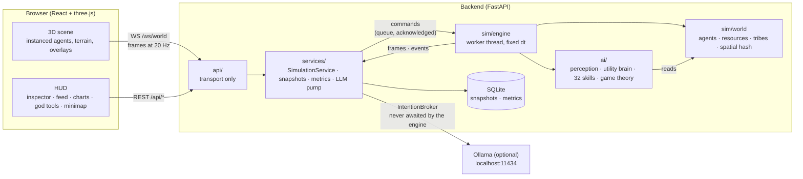

# Game Theory

An autonomous 3D society simulation: agents with needs, personalities and
game-theory strategies live on a soft pastel island. They gather, hunt, share,
steal, lie, gossip, form tribes, elect leaders, ally, betray and go to war -
with no player input. You are the observer: orbit, zoom, follow an agent,
fast-forward, inspect minds, change the rules, reset, and see which strategies
survive.

Runs entirely on `localhost`. **No paid services, no API keys, no cloud AI.**

- Design: [`docs/SPEC.md`](docs/SPEC.md)
- Build plan: [`docs/PROMPTS.md`](docs/PROMPTS.md)
- Senior review, with what is left and why: [`docs/REVIEW.md`](docs/REVIEW.md)
- Architecture decisions: [`docs/adr/`](docs/adr/) - [0001 architecture](docs/adr/0001-architecture.md),
  [0002 simulation core](docs/adr/0002-simulation-core.md),
  [0003 game theory and tribes](docs/adr/0003-game-theory-and-tribes.md),
  [0004 LLM minds](docs/adr/0004-llm-minds.md),
  [0005 god tools, presets, snapshots](docs/adr/0005-god-tools-presets-snapshots.md),
  [0006 the run archive](docs/adr/0006-the-run-archive.md)
- Working rules for Claude Code: [`CLAUDE.md`](CLAUDE.md)

---

## Status: Phase 7 of 7 (reviewed and hardened)

What works right now:

| Works | Not yet |
| --- | --- |
| **A real simulation**: seeded island, resources with regrowth, day/night, seasons | |
| Agents with needs, traits, inventory, ageing and named death causes | |
| **32 skills**: survival, building, social, manipulation, combat and tribe actions - every one declaring the named inputs behind its score | |
| Utility AI whose trace **names its reasons**: "Sleep 0.19 - tired +0.12, it is night +0.07" | |
| **Deliberative minds**: goals, plans, spoken lines and beliefs, via local Ollama **or an offline mock** | |
| LLM monitor: provider, reachability, call log with real prompts and replies | |
| **Six presets** with real values, from Peaceful Eden to Liars' Island | |
| **God tools**: drop food, bounty, drought, plague, spawn, smite | |
| **Snapshots**: save and reload a whole society, memories included | |
| **A durable record of every run** in SQLite - its seed and config, its metrics, and a capped event log - so the charts keep the whole run instead of their last 2,000 samples | |
| Inspector with needs, a **personality radar**, the decision trace, relationships and memories | |
| Minimap with a camera marker, click-to-fly, and a screenshot button | |
| Activity heatmap and name tags - every overlay toggle now does something | |
| **Tournament mode**: round-robin iterated PD with replicator dynamics, in a ring arena | |
| **Five games**: Prisoner's Dilemma, Stag Hunt, Hawk-Dove, Ultimatum, Public Goods | |
| **Ten strategies** from AlwaysCooperate to Detective, inherited with mutation | |
| **Trust you earn and reputation you only hear about**, gossip, lies, lie detection | |
| **Tribes** that are founded and joined, with leaders, storage, territory, coups that succeed, wars, peace deals and pacts between tribes | |
| Shelters that get built, reproduction with trait blending, deaths with causes | |
| Engine on a worker thread: pause / play / 1x-50x / MAX / step / reset | |
| Full UI: front screen with instructions, inspector, event feed with filters, charts, overlays, speech bubbles, URL state, help | |
| 7 layering contracts, **419 backend tests**, 34 unit + **14 browser tests** | |

`GET /api/sim/state` reports `"placeholder": false`. Determinism is
machine-checked: same seed, same world, to the bit, after 1,000 ticks of the
full pipeline, with the LLM off. (With it on, replies arrive on the event loop
and no seed controls that timing - set `llm_agents: 0` for a reproducible run.)

**No model is required.** The default provider is an in-process mock that
builds a deterministic plan from the prompt, so goals, speech bubbles and the
monitor all work with nothing installed. See
[Using a real model](#using-a-real-model-optional) to point it at Ollama.

### What a world actually does

From 10,000 ticks on the default seed (1337), engine only so that the run is
reproducible - the same quantities the UI reads from `/api/metrics` and
`/api/tribes`, measured rather than taken from the design document:

| | |
| --- | --- |
| Population | 120 spawned -> 129 alive, 16 births against 7 deaths (4 starved, 3 killed) |
| Tribes | 16, named, each with a leader, a store and territory |
| Shelters built | 70 |
| Cooperation rate | 59% in the Prisoner's Dilemma, 79% Hawk-Dove, 58% Stag Hunt |
| Food Gini | 0.76 - the island has developed a rich and a poor |
| Trust density | 0.18 of all possible trust edges actually exist |
| Gifts / betrayals | 757 / 82 |
| Lies told / caught | 842 / 293 |
| Diplomacy | 10 wars, 10 peace deals, 20 pacts, 4 coups won of 88 attempted |

Nobody has died of old age by tick 10,000 - that is 12.5 years at the default
three years a day, and they start between 18 and 50. Leave it running: by
30,000 ticks the island settles into a replacement equilibrium, 40 births
against 42 deaths with 40 of those old age, which is the churn inherited
strategies are selected by.

### Measured on this machine

`python driver.py --bench` (pure engine, no server, no pacing). These numbers
are for the **full pipeline** - encounters, gossip, tribes and the
deliberative layer included:

| Agents | Ticks/sec | vs realtime (1x = 10 ticks/s) | Phase 4 was |
| --- | --- | --- | --- |
| 100 | 283 | 28x | 341 |
| 500 | 50 | 5.0x | 42 |
| 1000 | 22 | 2.2x | 17 |

500 and 1,000 agents got *faster* than Phase 4 despite the deliberative layer
being added, because a property test found a real bug in the spatial hash on
the way (see below) and fixing it also made the hot path cheaper. The 100-agent
case is slower because four deliberative agents are 4% of a small world and
0.4% of a large one.

The default world of 120 agents therefore runs comfortably at any preset up to
25x. At 500 agents the sustainable preset is 5x; at 1,000 it is 1x. Presets
above the sustainable rate are not an error - the engine runs as fast as the
CPU allows and `ticks_per_second` in `/api/sim/state` tells you what you are
really getting. World build is 0.4 s at every size.

### Where the time actually goes

Profiled at 500 agents (`cProfile`, 400 ticks of the full pipeline):

| | calls per 400 ticks | self time |
| --- | --- | --- |
| `SpatialHash.query_radius` | 495,097 | 26% |
| `UtilityBrain._score_all` (cumulative) | 13,983 | 44% |

The brain used to score all 31 skills per decision. Each skill now declares
the cheap facts it cannot run without, and the impossible ones are skipped -
about a quarter of all scoring, worth 4-8% of wall clock. It is safe because
a test asserts, over every agent in a running world, that a skipped skill's
`check()` would have failed anyway; that machine check is why this landed and
a per-tick neighbour cache did not (measured at ~4%, *unsafe*, reverted - see
[`docs/adr/0005`](docs/adr/0005-god-tools-presets-snapshots.md)).

The remaining cost is the survival skills' spatial queries, which can never be
skipped because an agent always needs to eat. Full detail, with the A/B
numbers, in [`docs/REVIEW.md`](docs/REVIEW.md).

**Survivability is a tested invariant**, not an assumption: 92-99% of the
population survives 6,000-12,000 ticks across seeds, with occasional
starvation as the remaining pressure. See
[`docs/adr/0002-simulation-core.md`](docs/adr/0002-simulation-core.md) for the
two balance bugs that made the first cut of the simulation kill 88% of its
population while every unit test passed,
[`docs/adr/0003-game-theory-and-tribes.md`](docs/adr/0003-game-theory-and-tribes.md)
for the metrics-sampling and coup-accounting bugs that only a running world
exposed, and [`docs/adr/0004-llm-minds.md`](docs/adr/0004-llm-minds.md) for a
runtime setting that was tested, documented, settable from the API - and wired
to nothing at all.

The neighbour search had a real correctness bug until Phase 5: it scanned a
span of cells around the query's *cell*, when the query point can sit anywhere
inside that cell, so an agent standing within a whisker of a cell border could
not see a neighbour at the edge of its vision. Hypothesis found it; the fix
(derive the cell range from the circle's bounding box) is both correct and
about 20% faster at 500+ agents, because the exact box is often 2x2 cells
where a span was always at least 3x3.

---

## Using a real model (optional)

Everything above works with no model installed - the default provider is an
in-process mock. To let a few agents think with a real local model instead:

```powershell
# 1. Install Ollama for Windows (I will not install it for you):
#    https://ollama.com/download
#    Then, in a new terminal:

ollama pull qwen3:8b            # ~5 GB, good instruction following
# or, on a smaller machine:
ollama pull qwen3:4b            # ~2.5 GB
# or smaller still:
ollama pull llama3.2:3b         # ~2 GB

ollama list                     # confirm it is there
curl http://localhost:11434/api/tags   # confirm the daemon answers
```

Then either switch provider at runtime in the **LLM minds** panel (`m`), or
set it before starting in `.env`:

```ini
LLM_PROVIDER=ollama
OLLAMA_MODEL=qwen3:8b
OLLAMA_URL=http://localhost:11434
LLM_MAX_CONCURRENCY=1
LLM_MAX_CALLS_PER_MIN=30
LLM_HIGH_SPEED_POLICY=reduced
```

How many agents deliberate is a world setting, not a process one -
`llm_agents` in `backend/config/default.yaml` (4 by default, up to 64). Raise
it and lower `LLM_MIN_INTERVAL_SIM_S` for a noisier island; a local 8B model
on one GPU will comfortably keep a handful of agents thinking.

Nothing here reaches the public internet, and there is no API key anywhere in
the project. If the daemon is not running you get a banner saying so, agents
carry on with utility AI, and the circuit breaker stops the retry storm.

---

## How it fits together



The arrow that matters is the last one: the engine posts a request and carries
on ticking, so a slow or missing model costs you thoughts, never frame rate.
`ai/` reads `sim/` and never the reverse, and seven import-linter contracts
fail the build if any of that stops being true.

## Controls

| Key | Does |
| --- | --- |
| `Space` | Play / pause |
| `.` | Step one tick |
| `1` … `7` | Speed 1x, 2x, 5x, 10x, 25x, 50x, MAX |
| `R` | New world (preset picker, seed, dials) |
| Drag / scroll | Orbit and zoom |
| `WASD` / arrows | Pan |
| `Q` / `E` | Rotate |
| Click an agent | Inspect it |
| Double-click | Fly there |
| `F` / `Esc` | Follow the selected agent / stop following |
| `T` | Trust lines (green ally, red enemy) |
| `G` | Tribe territories |
| `B` | Speech bubbles |
| `C` | Charts |
| `L` | Event log |
| `M` | LLM minds monitor |
| `K` | God tools |
| `O` | Minimap |
| `?` | This list, in the app |

Every panel toggle is also a button, bottom right. The URL keeps the seed,
speed, selected agent and open panels, so a link reproduces what you are
looking at.

## Presets

`config/presets/*.yaml`, loaded at runtime - they are plain `WorldConfig`
overrides, so you can edit them or add your own without touching code.

| Preset | The question it asks |
| --- | --- |
| **Peaceful Eden** | What does trust look like when nothing forces anyone to cheat? |
| **Harsh Winter** | Does cooperation survive hunger? (winter, scarcity 2.2) |
| **Liars' Island** | What happens to reputation when nobody is honest? |
| **Tribal Wars** | Four tribes, contested ground, loyalty over honesty |
| **Axelrod Tournament** | Which strategy actually wins, with survival switched off - and it reproduces the classic answer: AlwaysDefect leads generation 1 and is extinct by 19, TitForTat finishes first |
| **LLM Schemers** | Six deliberative minds among reactive ones, plotting out loud |

A preset applies *on top of* the dials in the New World dialog, and never
overrides the seed - so "Tribal Wars with 300 agents on seed 99" is one click.

## God tools

Press `K`. Local tools land on the selected agent, or the middle of the island
when nothing is selected, and everything you do appears in the event feed.

| Tool | Effect |
| --- | --- |
| Drop food | Scatters bushes - the simplest way to end a famine |
| Good season | Refills every patch nearby and speeds up its regrowth |
| Drought | Dries up the water, which agents never plan around |
| Plague | Hurts everyone nearby; lethal for the weak, survivable for the rest |
| Spawn | One new agent, with a strategy and brain you choose |
| Smite | Kills the selected agent |

Snapshots live in the same panel: save the world as it is (agents, resources,
tribes, huts *and* every agent's memories), then load it back later. Terrain is
not stored - it comes back from the config and the seed.

---

## Before you start: two things about this machine

1. **Port 8000 is taken by Apache** (`httpd`). The backend cannot bind it as
   shipped. Either stop that service, or run the backend on another port -
   everything follows the port automatically:

   ```powershell
   .\scripts\dev.ps1 -BackendPort 8001      # non-Docker
   # or, for Docker:  BACKEND_PORT=8001 in .env
   ```

2. **Node 20.12.1 is below what the toolchain wants.** Vite needs >= 20.19,
   and Vite 8 / vitest 5 need >= 22.14 (their native bindings are skipped on
   Node 20, so vitest cannot start at all). The frontend is therefore pinned to
   Vite 7 + vitest 3, which work here. Node 20 is also past end-of-life.
   **Upgrading to Node 22 LTS is recommended**, after which:

   ```powershell
   cd frontend
   npm install -D vite@latest vitest@latest @vitejs/plugin-react@latest jsdom@latest
   ```

   That also clears the two `npm audit` advisories, which are in vitest 3 and
   are dev-only (the test runner is never shipped).

---

## Quickstart

One command installs what is missing, picks a free port, starts both servers
and opens the browser:

```powershell
python driver.py
```

| Command | What it does |
| --- | --- |
| `python driver.py` | Install if needed, start backend + frontend, open the browser |
| `python driver.py --check` | Every linter, type check and test suite (9 checks) |
| `cd frontend && npm run e2e` | 14 browser tests (needs the stack running; `npm run e2e:install` once) |
| `python driver.py --bench` | Throughput benchmark |
| `python driver.py --port 8001` | Pin the backend port (default: first free from 8000) |
| `python driver.py --no-frontend` | Backend only |
| `python driver.py --no-reload` | Do not restart the backend when its sources change |

See [Controls](#controls) for the keyboard map.
| `python driver.py --install` | Install dependencies and exit |

It needs nothing but the system Python - stdlib only - and Ctrl+C stops both
servers and their children.

### Or by hand

```powershell
# 1. backend
cd backend
uv sync
uv run uvicorn app.main:app --port 8000                # or --port 8001
# Note: --reload hangs on this host (see ADR 0003). `python driver.py`
# watches the sources and restarts the backend itself instead.

# 2. frontend (second terminal)
cd frontend
npm install
npm run dev
```

Open <http://localhost:5173>. API docs: <http://localhost:8000/docs>.
`scripts\dev.ps1` does the same in two PowerShell windows.

PyCharm users: the shared run configurations in `.run/` (**Backend
(uvicorn)**, **Frontend (vite)**, **Backend tests**, **Compose up**) appear in
the run-configuration dropdown automatically.

## Quickstart - with Docker

```powershell
copy .env.example .env
docker compose up --build                    # backend :8000, frontend :5173
docker compose --profile llm up --build      # ... plus a containerised Ollama
```

On Windows the simpler LLM setup is **native Ollama** (it gets the GPU without
passthrough); leave the `llm` profile alone and the backend reaches the host
daemon at `host.docker.internal:11434`.

---

## Commands

| Where | Command | What |
| --- | --- | --- |
| `backend/` | `uv run uvicorn app.main:app --reload --port 8000` | Run the API |
| `backend/` | `uv run pytest` | Tests |
| `backend/` | `uv run ruff check . ; uv run ruff format .` | Lint and format |
| `backend/` | `uv run mypy app` | Type check (strict) |
| `backend/` | `uv run lint-imports` | **Layering contracts** |
| root | `python driver.py` | Run the whole stack |
| root | `python driver.py --check` | All 9 checks |
| `backend/` | `uv run python -m app.tools.bench --agents 500 --ticks 2000` | Throughput |
| `backend/` | `uv run python -m app.tools.dump_openapi` | Schema without a server |
| `frontend/` | `npm run dev` | Vite dev server |
| `frontend/` | `npm run build` / `npm run typecheck` / `npm run lint` | Build and checks |
| `frontend/` | `npm run test` | Unit tests (vitest) |
| `frontend/` | `npm run e2e` | Playwright smoke (needs `npm run e2e:install` once) |
| `frontend/` | `npm run gen:api` | Regenerate REST types from a running backend |
| `frontend/` | `npm run gen:api:offline` | ... from a dumped `openapi.json` |
| root | `docker compose up --build` | Whole stack |

## Layout

```
GameTheory/
  driver.py  CLAUDE.md  README.md  docker-compose.yml  .env.example  .run/
  docs/      SPEC.md  PROMPTS.md  adr/
  backend/   pyproject.toml  Dockerfile  config/
             app/
               main.py        app factory
               container.py   the one composition root
               core/          settings, logging, Result, WorldConfig
               api/           routers, DTOs, WS hub        (transport only)
               services/      simulation, engine factory, world queries, metrics
               sim/           PURE deterministic engine
                 balance.py   every tuning dial, in one file
                 engine.py    worker thread, command queue, frame output
                 worldgen/    terrain, resources, population
                 systems/     needs, movement, regrowth, lifecycle
               ai/            perception, minds, brains, skills, game theory, llm
                 skills/      the 8 survival skills + registry
                 systems/     perception, decision, skill execution
               persistence/   SQLModel + repository
               tools/         bench, openapi dump
             tests/{sim,ai,api}/
  frontend/  package.json  Dockerfile  nginx.conf  vite.config.ts
             src/{app,api,state,scene,ui,lib}  tests/  e2e/
  data/      (gitignored - SQLite and snapshots)
```

## How the layering is enforced

`uv run lint-imports` checks seven contracts, so the architecture fails CI
rather than review. The strongest one is determinism: **`sim/` may not import
`time`, `datetime`, `random`, `secrets` or `uuid`.** The engine gets a seeded
`numpy.random.Generator` per named substream and an injected `Pacer` for wall
time. See ADR 0001 for the one place we deliberately tightened SPEC 2.1.

## Troubleshooting

| Symptom | Cause and fix |
| --- | --- |
| `error while attempting to bind on address ('127.0.0.1', 8000)` | Something else owns the port - here, Apache. Use `-BackendPort 8001`. |
| Frontend shows "Connecting to the simulation..." forever | Backend is not running, or is on a different port than the Vite proxy. Set `VITE_BACKEND_URL` or use `scripts/dev.ps1`. |
| `vitest` fails with "Cannot find native binding" | Node is below the version its bindings require. Use Node 22 LTS, or the pinned Vite 7 / vitest 3. |
| An endpoint returns **501** | Intentional: the response body names the phase it lands in. |
| `llm.reachable: false` in `/api/health` | Expected without Ollama. The app falls back to deterministic mock plans and keeps working. |
| Playwright: "browser not installed" | `npm run e2e:install` (downloads Chromium once). |
| Agents float above or sink into the island | Terrain and agents must share one sampler. Both read the backend heightmap via `src/api/terrain.ts`; the noise island in `src/lib/terrain.ts` is only the fallback for when `/api/world/terrain` is unreachable. |
| Everyone dies within a few sim-days | A balance regression. Run `uv run pytest tests/sim/test_balance.py` - it reports the death causes. |

## Cost and safety

No cloud AI, no API keys, no billing - by design and by rule (`CLAUDE.md`). The
only outbound network call the backend can make is to Ollama on the configured
local URL. `MockProvider` is the default, so the whole application works with
nothing installed.
